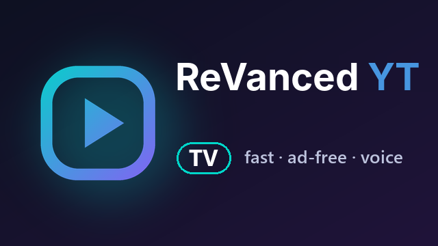

<p align="center"></p>

# ReVanced YT TV

An ad-free YouTube app for Android TV, built for weak boxes but able to play the best formats your
TV can show: up to **4K 60 fps**, **HDR10 / HLG** and **surround sound**. It runs YouTube's own TV
interface full screen, blocks ads with Brave's ad-block engine, and adds **voice search** on the
remote's mic button.

[](../../actions/workflows/build.yml)

> **Not affiliated** with YouTube, Google, Brave, the ReVanced project or the former YouTube Vanced
> project. "YouTube" is a trademark of Google LLC. This app shows YouTube's own TV website inside
> Android's WebView; it does not modify or redistribute the YouTube app.

## Screenshots

<p align="center">
  <br>
  <b>Home screen</b>
</p>
<br>

<p align="center">
  <br>
  <b>Video stats</b>
</p>
<br>

<p align="center">
  <br>
  <b>Surround Audio</b>
</p>
<br>

<p align="center">
  <br>
  <b>Audio Stats</b>
</p>


## Features

| | |
|---|---|
| **No ads** | [adblock-rust](https://github.com/brave/adblock-rust), Brave's engine, runs natively with uBlock Origin's scriptlets, which strip ad slots out of the player before YouTube's code runs. Network ads and trackers are blocked with EasyList, EasyPrivacy, Peter Lowe's list and the uBlock Origin lists. |
| **Best quality the TV can show** | The app tells YouTube's player what the box's hardware decoder and the TV can really play, so it gets up to 4K, HDR on HDR TVs and surround audio, instead of WebView's default 720p stereo. See [Supported formats](#supported-formats). |
| **Voice search** | Press the remote's mic button, or the mic on YouTube's search screen, and say what you want to watch. Android's speech recognition turns it into a YouTube search. In other apps the mic button still opens Google Assistant. |
| **The official TV look** | Fixes for the settings YouTube sends to low-end TVs: no black boxes behind titles, gradients and full-size thumbnails restored, animations kept off so weak boxes stay smooth. |
| **Fast start** | Videos start in about 2 seconds. The app identifies itself as a smart TV that gets plain (non-DRM) streams. |
| **TV remote keys** | OK, Back (with YouTube's own "Exit?" screen), Channel ± to page through lists, and media keys. |
| **Light** | No Google Play Services needed, one small native library, and the filter lists come pre-compiled, so start-up on a slow CPU takes about a second. |

## Supported formats

YouTube picks the stream; the app answers its "can you play this?" questions with the real abilities
of **your box's hardware video decoder** and **your TV's HDR support** (read by Android over HDMI).
So the maximum below is reached only when the box and TV support it; otherwise you get the best
they do support.

| | Maximum | Notes |
|---|---|---|
| **Resolution** | 2160p (4K) | Limited to what the box's hardware decoder can play. Tested: 3840×2160 HDR, 0 dropped frames. |
| **Frame rate** | 60 fps | Within the decoder's limits at that resolution. |
| **Video codecs** | AV1, VP9 (8- and 10-bit), H.264 | YouTube prefers AV1, then VP9, when the box decodes them in hardware. |
| **HDR** | HDR10 (PQ), HLG | Only when the TV reports HDR to the box; otherwise the normal SDR version plays, so colours are never washed out. YouTube does not stream Dolby Vision; Dolby Vision TVs get HDR10. |
| **Surround audio** | Eclipsa Audio (IAMF), Dolby Digital (AC-3), Dolby Digital Plus (E-AC-3), 5.1 | YouTube sends surround tracks when Android System WebView can decode them; then *Settings → Audio → Surround sound* shows **On**. Tested: Eclipsa Audio (`iamf.001.001.Opus`). Otherwise stereo Opus. |
| **Stereo audio** | Opus, AAC | Always available. |
| **360° videos** | Ambisonic spatial audio | Played like any other video. |

You can check what is playing in **stats for nerds** (*Settings → Stats for nerds* in the player):
the *Codecs* line shows the video and audio codec, *Color* shows `smpte2084 (PQ) / bt2020` for HDR,
and *Current / Optimal Res* shows the resolution.

**Known limits**

- **Surround over HDMI:** WebView decodes the surround track itself and sends PCM audio to the TV or
  AV receiver. Whether it arrives as multichannel PCM (5.1) or is mixed down to stereo depends on the
  box; it is not passed through as a Dolby bitstream. If your receiver shows *Multi Ch PCM*, you
  have 5.1; *PCM 2.0* means stereo.
- **1080p TV with a 4K box:** the quality is capped by the decoder, not the TV's resolution, so such
  a setup may stream 4K and scale it down (more data, no sharper picture). Pick a lower quality in
  the player if needed.
- HDR needs the box's HDMI output to report HDR. If the box has an "SDR only" or "HDR off" setting,
  turn it off for HDR.

## Requirements

- Android TV **9 or newer** (it installs from Android 8.0)
- ARM CPU, 32-bit (`armeabi-v7a`) or 64-bit (`arm64-v8a`)
- An up-to-date **Android System WebView**: AV1, HDR and surround support come from it

Developed on the Airtel Xstream Smart Box (Android TV 9, 32-bit ARM).

## Install

1. Download `ReVanced-YT-TV-<version>.apk` from the [latest release](../../releases/latest), or from
   the newest green run under [Actions](../../actions/workflows/build.yml).
2. Install it with ADB over the network (*Developer options → Network debugging* on the box):

   ```sh
   adb connect <box ip>
   adb install -r ReVanced-YT-TV-<version>.apk
   adb shell pm grant com.myyt.tv android.permission.RECORD_AUDIO
   ```

   Without ADB, any "send files to TV" app plus a file manager works too. The app asks for the
   microphone the first time it opens, before YouTube loads.

3. **Turn on the remote's mic button.** Android TV sends the remote's mic key to Google Assistant
   before any app sees it. A small accessibility service, **"ReVanced YT TV mic button"**, takes that
   key back, only while ReVanced YT TV is on screen. It reads no screen content. Turn it on in
   *Settings → Device Preferences → Accessibility*, or over ADB:

   ```sh
   adb shell settings put secure enabled_accessibility_services com.myyt.tv/.MicKeyService
   adb shell settings put secure accessibility_enabled 1
   ```

   If another accessibility service is already listed, keep it: join both with a `:`.

> The package name stays `com.myyt.tv`, so an update installs over earlier builds (including
> VancedYT-TV) and keeps your YouTube sign-in, as long as the APK is signed with the same key.

### Voice search needs these system apps

On the Airtel box, the remote's mic needs `com.google.android.tv.remote.service`,
`com.google.android.speech.pumpkin`, `com.google.android.katniss` and `com.uei.uas.airtel`. Don't
disable them when cleaning up the box.

## Build

GitHub Actions builds every push ([workflow](.github/workflows/build.yml)): first the Rust engine with
`cargo-ndk` for 32- and 64-bit ARM, then the APK. Pushing a `v*` tag publishes a release with the APK.

**Signing:** set the repository secret `SIGNING_KEYSTORE_B64` to your keystore (base64) so every build
is signed with the same key and installs as an update. Without it, builds are signed with a throwaway
debug key and cannot update an existing install.

To build locally you need JDK 17, Android SDK 34 with the NDK, Rust, and `cargo install cargo-ndk`:

```sh
rustup target add armv7-linux-androideabi aarch64-linux-android
cd engine && cargo ndk -t armeabi-v7a -t arm64-v8a --platform 26 -o ../app/src/main/jniLibs build --release --lib && cd ..
./gradlew assembleRelease
```

### Updating the filter lists

The lists are compiled on a computer into `app/src/main/assets/engine.dat`; the TV only loads the
finished file.

```sh
# scriptlet resources from uBlock Origin's scriptlets (engine/ubo) and Brave's resources.json
python -I engine/build_resources.py engine/ubo engine/resources.json app/src/main/assets/resources.json
# compile (an example list set; lists marked trusted: may use trusted scriptlets, as in Brave)
cd engine && cargo run --release --bin compile -- ../app/src/main/assets/engine.dat \
  ../app/src/main/assets/resources.json \
  trusted:../lists/ubo-filters.txt trusted:../lists/ubo-privacy.txt trusted:../lists/ubo-unbreak.txt \
  trusted:../lists/ubo-quick-fixes.txt trusted:../lists/brave-unbreak.txt trusted:../lists/brave-specific.txt \
  ../lists/easylist.txt ../lists/easyprivacy.txt ../lists/peterlowe.txt
```

Fresh lists can be downloaded from their projects (links below). `compile` loads the result back and checks
that a known ad URL is blocked.

## How it works

- `MainActivity`: a full-screen WebView on `youtube.com/tv` with a smart-TV user agent, remote key mapping and
  full-screen video. It opens YouTube with switches that YouTube's TV app reads before the server's
  low-end-TV settings: `env_enableSoftMic` and `env_enableWebSpeech` bring the mic button back, and
  `env_isLimitedAnimation` restores the full look while keeping animations off.
- `MediaCaps`: answers the TV player's `MediaSource.isTypeSupported` questions with their TV-browser
  parameters (`width`, `height`, `framerate`, `eotf`) from Android's hardware decoders and the
  display's HDR capabilities. WebView alone says yes to everything, so the player would fall back to
  720p SDR. It also removes the black boxes YouTube draws behind text on low-end TVs.
- `AdBlock` + `engine/`: the JNI bridge to adblock-rust. Network requests are checked in
  `shouldInterceptRequest`, cosmetic rules are added as CSS, and the YouTube scriptlets run as a
  document-start script.
- `Voice`: Android `SpeechRecognizer`, offered to the page as the Web Speech API. A search from the remote
  opens `#/search?q=…` in YouTube's TV app.
- `MicKeyService`: takes the remote's mic key (`KEYCODE_ASSIST`) while the app is in front.

## Licence and credits

GPL-3.0 (see [LICENSE](LICENSE)), because the app ships uBlock Origin's scriptlets.

- [uBlock Origin](https://github.com/gorhill/uBlock) scriptlets and filter lists, © Raymond Hill and
  contributors, GPL-3.0 (`engine/ubo`, `lists/ubo-*`)
- [adblock-rust](https://github.com/brave/adblock-rust) and Brave's lists and resources, © Brave Software, MPL-2.0
- [EasyList / EasyPrivacy](https://easylist.to), GPL-3.0 / CC BY-SA 3.0
- [Peter Lowe's list](https://pgl.yoyo.org/adservers/)
- [App logo affiliated to revanced team](https://www.reddit.com/r/revancedapp/comments/1h2ee49/youtube_vanced_logo/)
